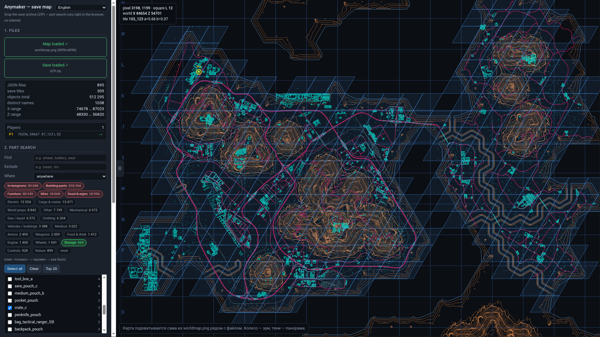
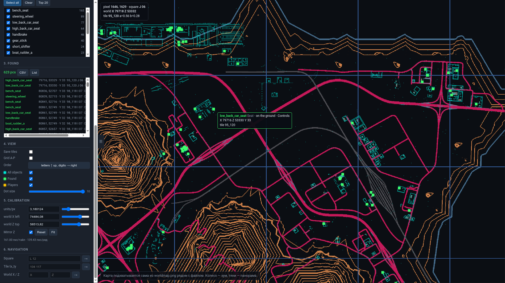

# AnyMakerToolMap

[English](README.md) · **Русский**

Репозиторий: <https://github.com/NicRoss512/AnyMakerToolMap> · Сайт: <https://nicross512.github.io/AnyMakerToolMap/>

**Интерактивная карта сейва Anymaker и поиск запчастей по всему сохранению.**
Один HTML-файл: открывается двойным кликом, всё считается прямо в браузере,
интернет не нужен, а сохранение вообще никуда не отправляется.



Что умеет:

- перетащил ZIP со сейвом — и ищешь по всему миру: `engine`, `battery`, `wheel`,
  `food_`, `keycard`… 600–1000 разных названий, полмиллиона объектов;
- показывает каждую находку **на карте** с координатами, тайлом (`104_117`) и
  квадратом сетки (`L 12`);
- **категории из данных самой игры** (стройматериалы, мебель, еда, одежда,
  оружие, электрика…) — чипсы «только / кроме» выкидывают мусор в один клик;
- отдельный фильтр **«В данжах»** — подземки не мешают искать на поверхности;
- позиции игроков (в сетевой игре — всех), слой техники, экспорт в CSV;

---

## Быстрый старт

**Онлайн (GitHub Pages):** <https://nicross512.github.io/AnyMakerToolMap/>

**Локально:**

1. Скачайте `save_map.html` и `worldmap.png` **в одну папку**.
2. Запакуйте свой сейв в ZIP (как — ниже).
3. Перетащите ZIP в правую зону окна.
4. Введите в поиск, например, `engine`, и отметьте нужные названия.

---

## 1. Где лежит сейв и как его запаковать

Сейвы лежат здесь:

```
%appdata%\Anymaker\saves\
```

(вставьте эту строку в адресную строку проводника). Внутри — папки сохранений,
а в каждой: `meta.json`, `scene.json`, `tiles/`, `dungeons/`.

**Как запаковать:**

- **Проводник Windows:** зайти в `saves`, правый клик по папке сохранения →
  *Отправить → Сжатая ZIP-папка*.
- **7-Zip / WinRAR:** правый клик → *Добавить в архив* → формат **zip**.
- **Терминал:** `cd %appdata%\Anymaker\saves && tar -a -c -f save.zip папка_сейва`
  или `zip -r save.zip папка_сейва`.

Что важно:

- нужен именно **ZIP** (`.rar` и `.7z` не поддерживаются);
- внутри архива должны быть **сами файлы** (`meta.json`, `scene.json`,
  `tiles/*.json`, `dungeons/*.json`) — неважно, в папке они или в корне,
  инструмент найдёт все `*.json` на любой глубине;
- распаковывать архив не нужно — он читается прямо из памяти браузера (JSZip);
- сейв на 100 МБ разбирается примерно за 10–30 секунд, прогресс виден.

Архив можно не переименовывать: если браузер капризничает с расширением,
в инструменте есть кнопка выбора файла.

---

## 2. Карта

`worldmap.png` — это экспорт карты из игры (4096×4096, карта не процедурная,
она одна и та же для всех миров). Положите её **рядом с `save_map.html`** —
карта подхватится сама при открытии. Если файла рядом нет, инструмент
попросит перетащить PNG вручную.

Картинка нужна только чтобы рисовать точки: поиск, координаты, тайлы, квадраты
и экспорт CSV работают и без неё.

---

## 3. Поиск

Поле **«Find»** ищет по подстроке в названии и в человеческом имени из игры,
через запятую — сразу несколько вариантов (`wheel,tyre`). Поле **«Exclude»**
выбрасывает лишнее: `barrel` + исключение `_a` оставит только `barrel_b`.

Регистр не важен. Результат — список названий с количеством; галочки
(«Select all» / «Top 20») превращают их в точки на карте и в список находок.

Примеры на реальном сейве: `engine` — 31 название, 1391 штука;
`battery` — 591; `wheel` — 565; `food_` — 658; `keycard` — 8.

---

## 4. Категории

Под строкой поиска — ряд чипсов с группами и числом объектов в сейве.
Клик переключает три состояния: **«только эта группа» → «кроме этой группы» →
как было** (зелёный / зачёркнутый / обычный). Можно включить несколько.

Группы: стройматериалы, мебель, двигатель, колёса, механика, газ и жидкость,
электрика, управление, оружие, патроны, одежда, еда и питьё, медицина,
хранение, разное, дороги и знаки, грузы и тара, природа, объекты мира, живое,
техника и здания.

Они **взяты из файлов самой игры** (`*_definitions.json`), а не придуманы:
у предметов берётся поле `class` (оно точнее `category` — у колёс
`class=wheel`, а `category=accessory`), у деталей — флаги
`is_building_furniture` / `is_building_component`, у пропов группа выводится по
названию. Покрытие на тестовом сейве — 100 % названий.

Зачем это нужно: на большом сейве (511 тыс. объектов) **62 % всего —
стройматериалы** (одних `building_b_wall` — 142 тысячи). Один чипс «кроме
стройматериалов» превращает полумиллионную кашу в ~196 тысяч осмысленных точек.

Набор нажатых чипсов запоминается в браузере.

---

## 5. Данжи

Первый чипс в ряду — **«В данжах»**, с той же логикой «только / кроме».
Это отдельный фильтр, потому что данж — свойство точки, а не предмета: одно и
то же название встречается и на поверхности, и в подземке. В тестовом сейве
**25 % всех объектов лежат внутри трёх данжей**, поэтому «кроме данжей» —
самый быстрый способ убрать из выдачи то, до чего всё равно не дойти.



---

## 6. Что видно на карте

| цвет | что это |
|---|---|
| бирюзовый | все объекты сейва (слой «All objects», по умолчанию выключен) |
| зелёный | найденное по текущему поиску |
| янтарный с подписью `P1`, `P2` | игроки |
| синие ромбы | тайлы сейва |

Слои переключаются в разделе **«View»**. Колесо — зум, тяни мышью — панорама;
при приближении рисуются все объекты кадра (склейка повторов включается только
когда в кадре больше ~80 тысяч точек).

Сетка **A-P / 00-15**: буквы идут по вертикали снизу вверх, цифры — по
горизонтали слева направо; левый нижний квадрат `A 00`, правый верхний `P 15`.
Порядок переключается кнопкой **«Order»** (вдруг в игре наоборот), слой сетки
по умолчанию выключен, чтобы не загораживать карту.

---

## 7. Навигация

- **Square** — переход по квадрату: `L 12`
- **Tile tx_ty** — по тайлу: `104 117`
- **World X / Z** — по мировым координатам: `80000 52000`

Кнопка **«☰»** на шве между панелью и картой скрывает панель — карта
разворачивается на всё окно.

---

## 8. Игроки

Позиции берутся из `scene.json` → `peers.peers[]`. В одиночной игре там один
игрок (это вы), в сетевой — по записи на каждого. Слой «Players» включён по
умолчанию: на карте янтарный кружок с подписью `P1…`, в панели — список с
координатами, тайлом и квадратом (клик — перелёт).

---

## 9. Экспорт в CSV

Кнопка **«CSV»** сохраняет все текущие находки:

```
name;worldX;worldZ;worldY;tile;square;source;zone;category;display_name
food_cola;83987.7;53644.2;32.9;103_120;K 11;on the ground;surface;Food & drink;Cola
```

`source` — откуда предмет (на земле / в технике / в контейнере / в инвентаре
NPC), `zone` — поверхность или `данж N`, `display_name` — человеческое имя
из игры.

---

## Как это работает

- **Сейв** — это набор JSON-чанков: `tiles/tile_<tx>_<ty>_*.json` (карта
  нарезана ромбами 512×443 м), `dungeons/`, `scene.json`, `meta.json`.
- **Имена** предметов лежат в `item._type`, а у деталей, продающихся как
  «заготовка», — в **`component_def`**: `vehicle_editor_add_component` с
  `component_def: mechanical_junction_abs`. Без этого поля поиск `engine`
  не находил вообще ничего (0 вместо 1391).
- **Категории** собираются из файлов игры скриптом `tools/make_cats.py`
  (подробности — в полной документации). Сами файлы игры в репозиторий
  не входят: это данные игры, берите их из своей установки.
- **Привязка к карте**: `px = (X − 74484.08) / 3.180124224`,
  `py = (58513.82 − Z) / 3.180124224` (4096×4096 px, 161 px на тайл).
  Найдено по 5 794 придорожным объектам: медианное расстояние до дороги на
  карте — 0 пикселей. Точная калибровка — в полной документации.
- **Ничего на сервер не уходит**: JSZip читает архив в памяти браузера,
  весь код внутри одного файла, сетевых запросов нет вообще.

---

## Инструменты в `tools/`

| файл | что делает |
|---|---|
| `chunk_scan.py` | разведка по чанкам: обходит все JSON сейва (папка или ZIP, только стандартная библиотека) и выдаёт все названия с количествами, схему полей, частоту слов, примеры объектов |
| `make_cats.py` | собирает `cats.js` — справочник категорий из файлов определений игры |
| `cats.js` | 1161 id → группа + человеческое имя; встраивается в `save_map.html` |
| `build.py` | сборка: `python3 build.py` в `_template2.html` вставляет `jszip.min.js` и `cats.js` |
| `_template2.html` | исходник `save_map.html` (править его, а не готовый файл) |
| `jszip.min.js` | JSZip 3.7.1 — вшивается в инструмент, чтобы работать офлайн |
| `mapref.py` | переводы «мир ↔ пиксель ↔ квадрат ↔ тайл» из командной строки |
| `tilemap.py` | чистая геометрия сетки тайлов |
| `unlocks_tool.py` | `unlocks.txt` ↔ JSON (расшифровка, перешифровка на другой аккаунт, слияние) |
| `extract_points.py` | выгрузить все объекты сейва в `points.npz` |
| `grid_table.csv` | все 256 квадратов карты: пиксели, границы в мире, тайлы внутри |

Быстро:

```bash
python3 tools/chunk_scan.py путь/к/архиву.zip        # что вообще есть в сейве
python3 tools/mapref.py world 85000 52000            # что в этой точке мира
python3 tools/unlocks_tool.py decode unlocks.txt <SteamID64>
```

---

## Полная документация

`docs/README_FULL.md` — всё подряд: формат `unlocks.txt`, геометрия сетки
тайлов, калибровка карты, разбор чанков по полям, как устроены категории.

---

## Дисклеймер

Неофициальный фанатский инструмент, никак не связан с разработчиками Anymaker.
Игра только читается: инструмент не меняет файлы сохранения, а сам сейв
никогда не покидает ваш компьютер. Файлы определений игры в репозиторий не
входят — берите их из своей установки.
